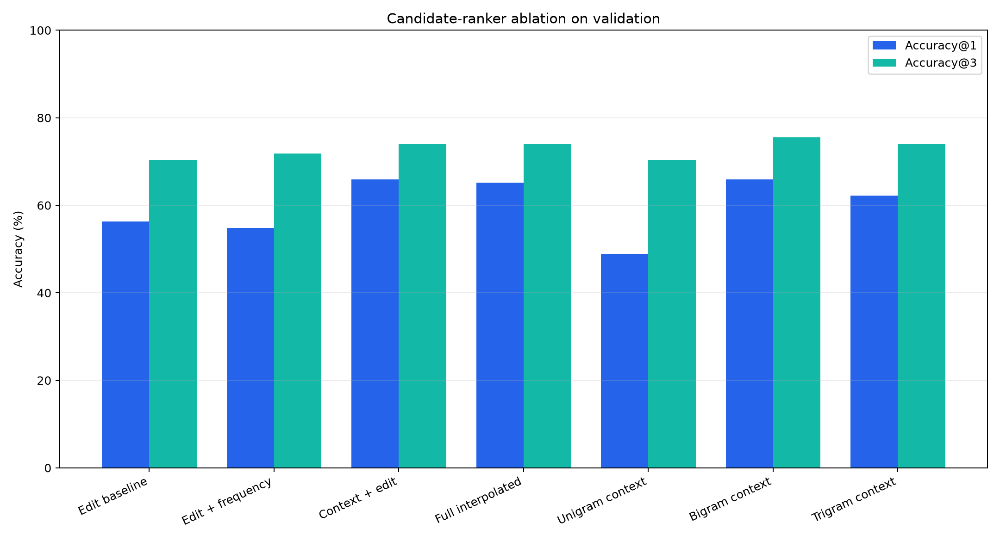
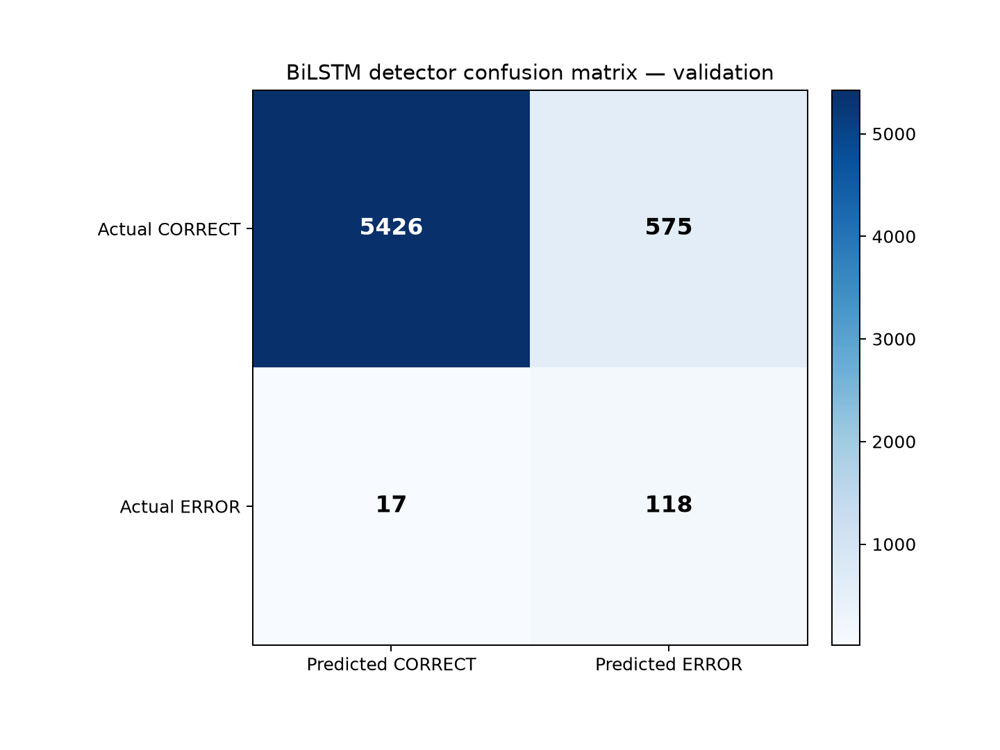
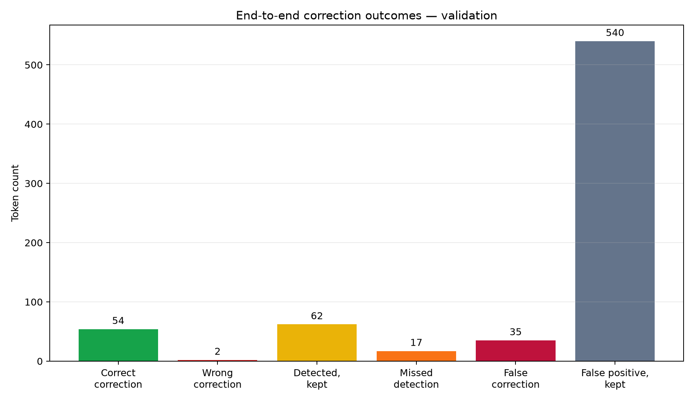

# BÁO CÁO ĐỒ ÁN XỬ LÝ NGÔN NGỮ TỰ NHIÊN

## Hệ thống phát hiện và sửa lỗi chính tả tiếng Việt

**Nhóm thực hiện:** [Điền tên thành viên]

**Giảng viên:** [Điền tên giảng viên]

**Học phần:** Xử lý ngôn ngữ tự nhiên

**Phiên bản báo cáo:** Bản nháp tiến độ — 16/11/2026

## 1. Tóm tắt

Đề tài xây dựng một hệ thống phát hiện và sửa lỗi chính tả tiếng Việt ở cấp độ
token. Hệ thống gồm BiLSTM detector được huấn luyện từ đầu, bộ sinh ứng viên dựa
trên Damerau–Levenshtein Distance và mô hình ngôn ngữ thống kê nội suy
unigram–bigram–trigram để xếp hạng ứng viên theo ngữ cảnh. Toàn bộ pipeline chạy
cục bộ, không sử dụng mô hình pretrained, embedding pretrained hoặc API AI tại
thời điểm suy luận.

Dữ liệu thử nghiệm hiện tại được trích xuất từ một shard chính thức của
Vietnamese Wikipedia dump ngày 01/11/2026. Hệ thống giữ 2.000 bài và sau khi
loại trùng còn 53.953 câu, được chia theo document thành train, validation và
test trước khi sinh lỗi tổng hợp. Thiết kế và tham số chỉ được lựa chọn trên
validation; test mở rộng vẫn chưa được sử dụng.

Trên validation, cấu hình hiện tại đạt Correction F1 61,21%, Accuracy@3 66,49%,
Sentence Accuracy 65,24% và False Correction Rate 0,40%. Kết quả cho thấy mô
hình ngữ cảnh cải thiện rõ so với baseline Edit Distance, trong khi các cơ chế
giữ nguyên và rank margin giúp ngăn phần lớn false positive của detector trở
thành sửa nhầm thực tế.

## 2. Bài toán và mục tiêu

Đầu vào của hệ thống là một câu tiếng Việt. Đầu ra gồm:

- Các token bị nghi sai và detector confidence.
- Tối đa ba ứng viên sửa lỗi cho mỗi token.
- Câu sửa tự động theo ứng viên Top-1.
- Khả năng giữ nguyên hoặc chọn ứng viên khác trên giao diện.
- Thông tin giải thích gồm Edit Distance, điểm ngữ cảnh và tần suất.

Phạm vi MVP tập trung vào lỗi thêm, xóa, thay, đảo ký tự và lỗi dấu tiếng Việt.
Đề tài không nhằm xử lý toàn bộ lỗi ngữ pháp, văn phong, phương ngữ hoặc lỗi cần
hiểu ngữ nghĩa sâu.

## 3. Ràng buộc và nguyên tắc

- BiLSTM và embedding được khởi tạo ngẫu nhiên, huấn luyện từ đầu.
- Không sử dụng BERT, PhoBERT, fastText pretrained hoặc checkpoint bên ngoài.
- Không gọi ChatGPT, Gemini, dịch máy hay dịch vụ sửa chính tả bên ngoài.
- Vocabulary, từ điển, tần suất và n-gram chỉ được fit trên train.
- Validation dùng để chọn tham số; test chỉ được chạy sau khi khóa thiết kế.
- Dữ liệu và artifact lớn được lưu cục bộ, không đưa vào GitHub.

## 4. Dữ liệu

Nguồn dữ liệu mở rộng là shard:

`viwiki-20261101-pages-articles3.xml-p3452086p4565246.bz2`

Nguồn chính thức:

`https://dumps.wikimedia.org/viwiki/20261101/`

Quá trình chuyển đổi quét 13.332 trang và giữ lại 2.000 bài viết thuộc namespace
chính, không phải redirect. Ban đầu hệ thống trích xuất 56.428 câu và 1.400.404
token.

Sau kiểm tra chất lượng:

- Loại 1.755 câu trùng chính xác.
- Loại 720 câu gần trùng ở threshold 0,95.
- Còn lại 53.953 câu.
- Train: 1.588 documents, 43.312 câu, 1.085.839 token.
- Validation: 199 documents, 4.779 câu, 124.790 token.
- Test niêm phong: 198 documents, 5.862 câu, 155.041 token.
- Vocabulary chỉ từ train: 40.127 token.
- Validation OOV rate: 3,22%.

Các split được tạo theo `document_id` trước khi sinh lỗi nhằm hạn chế leakage.
Mỗi split dùng seed cố định để sinh độc lập các lỗi delete, insert, substitute,
transpose và diacritic.

## 5. Kiến trúc hệ thống

### 5.1. Tiền xử lý

Văn bản được chuẩn hóa Unicode NFC, token hóa bằng quy tắc minh bạch và giữ
character span. Span cho phép thay token mà không làm mất khoảng trắng hoặc dấu
câu của câu ban đầu.

### 5.2. BiLSTM detector

Mỗi token được chuyển thành embedding 128 chiều. BiLSTM có hidden size 128 cho
mỗi chiều, một tầng và dropout 0,3. Hai trạng thái xuôi/ngược được ghép thành
vector 256 chiều và đưa qua Linear classifier để dự đoán `CORRECT` hoặc `ERROR`.

Cấu hình huấn luyện chính:

- Batch size: 32.
- Learning rate: 0,001.
- Tối đa 20 epoch.
- Gradient clipping: 1,0.
- Early stopping patience: 4.
- Seed: 42.

Checkpoint tốt nhất xuất hiện ở epoch 4; huấn luyện dừng sau epoch 8.

### 5.3. Candidate generator

Với token bị nghi sai, hệ thống tìm các từ gần nhất trong từ điển train bằng
unrestricted Damerau–Levenshtein Distance. Khoảng cách tối đa bằng 1 với từ ngắn
và 2 với từ dài. Candidate generator lập chỉ mục theo độ dài và cache kết quả để
giảm chi phí lặp lại.

### 5.4. Language model và ranker

Mô hình ngôn ngữ đếm unigram, bigram và trigram trên train sạch, sử dụng add-k
smoothing và nội suy với trọng số `(0,1; 0,3; 0,6)`.

Điểm ứng viên gồm:

`score = context_weight × context_score + edit_weight × edit_score`

Ablation cho thấy frequency score không cải thiện validation nên trọng số
frequency cuối cùng được đặt bằng 0.

### 5.5. Suy luận an toàn

Hệ thống luôn thêm phương án giữ nguyên vào danh sách ứng viên. Một thay đổi chỉ
được áp dụng khi chênh lệch điểm Top-1 và Top-2 vượt rank margin.

Cấu hình được chọn trên validation:

- Detector threshold: 0,50.
- Minimum rank margin: 1,00.
- Diacritic-only margin cho token OOV: 0,50.
- Title-case diacritic margin cho token OOV: 0,30.
- Keep-original bonus: 0,75.

Token đã xuất hiện trong từ điển train vẫn phải vượt global margin. Cơ chế này
giúp giữ từ hợp lệ và vẫn sửa được lỗi dấu OOV như `Hộm → Hôm`.

## 6. Quy trình hoạt động

1. Nhận câu tiếng Việt và chuẩn hóa Unicode NFC.
2. Token hóa, lưu character span và chuyển token thành ID.
3. BiLSTM trả xác suất lỗi cho từng token.
4. Token vượt detector threshold được đưa vào candidate generator.
5. Damerau–Levenshtein sinh tối đa năm ứng viên gần nhất.
6. Ranker chấm ứng viên bằng ngữ cảnh và Edit Distance.
7. Hệ thống so sánh rank margin và có thể giữ nguyên token.
8. Token được thay vào character span ban đầu.
9. Chương trình trả câu sửa, confidence, Top-3 và chi tiết điểm.

## 7. Kết quả thực nghiệm

### 7.1. Candidate generator

- Recall@1: 57,63%.
- Recall@3: 77,36%.
- Recall@5: 83,06%.
- Candidate dictionary size: 37.528.

### 7.2. Ranker

- Edit-distance baseline Accuracy@1: 57,63%.
- Context + Edit Accuracy@1: 75,12%.
- Mức tăng tuyệt đối: 17,49 điểm phần trăm.
- Context + Edit Accuracy@3: 81,61%.

### 7.3. BiLSTM detector

- Precision lớp ERROR: 40,21%.
- Recall lớp ERROR: 82,78%.
- ERROR-F1: 54,13%.

Detector ưu tiên recall nên tạo nhiều false positive. Vì vậy chất lượng sản phẩm
không được đánh giá chỉ bằng detector F1 mà phải xem thêm applied corrections và
false-correction rate.

### 7.4. End-to-end validation

- Correction precision: 69,88%.
- Correction recall: 54,45%.
- Correction F1: 61,21%.
- Accuracy@3: 66,49%.
- Sentence Accuracy: 65,24%.
- False Correction Rate: 0,40%.

Các kết quả trên thuộc validation mở rộng, chưa phải kết quả test cuối.

## 8. Ablation study của mốc smoke

Ablation dưới đây sử dụng 135 vị trí lỗi của mốc smoke và được giữ để giải thích
lựa chọn kiến trúc ranker:

- Edit baseline: Accuracy@1 56,30%.
- Edit + frequency, không context: 54,81%.
- Context + Edit, không frequency: 65,93%.
- Full interpolated có frequency: 65,19%.
- Unigram context: 48,89%.
- Bigram context: 65,93%.
- Trigram context: 62,22%.

Bigram thuần đạt ranking tốt khi vị trí lỗi đã biết nhưng Correction F1
end-to-end chỉ đạt 42,11%. Vì vậy hệ thống tiếp tục sử dụng mô hình nội suy và bỏ
frequency score.

## 9. Error analysis của mốc smoke

Phân tích dưới đây thuộc validation smoke 6.136 token. Error analysis cho corpus
mở rộng sẽ được tái tạo sau khi khóa cấu hình:

- True positive của detector: 118.
- False positive: 575.
- False negative: 17.
- True negative: 5.426.
- Sửa đúng: 54 token.
- Sửa sai tại vị trí lỗi: 2 token.
- Phát hiện lỗi nhưng giữ nguyên: 62 token.
- Token đúng bị sửa nhầm: 35 token.
- False positive được giữ nguyên an toàn: 540 token.

Kết quả cho thấy safe inference guards chặn phần lớn false positive của detector
khỏi trở thành sửa nhầm. Những lỗi còn lại tập trung ở tên riêng, token OOV và
các trường hợp từ sai quá xa từ đúng nên candidate generator không sinh được
đáp án phù hợp.

## 10. Giao diện demo

Giao diện Streamlit cho phép:

- Nhập câu hoặc chọn ví dụ.
- Tô sáng token bị nghi sai.
- Xem confidence và Top-3 ứng viên.
- Xem các thành phần điểm của ranker.
- Chọn ứng viên khác hoặc giữ nguyên.
- Xem câu sửa tự động và câu theo lựa chọn người dùng.

Giao diện chạy cục bộ bằng:

`python -m streamlit run app/streamlit_app.py`

## 11. Hạn chế

- Corpus hiện tại mới dùng 2.000 bài trong một shard Wikipedia.
- Validation OOV đã giảm còn 3,22% nhưng tên riêng và token hiếm vẫn khó sửa.
- Lỗi tổng hợp chưa phản ánh đầy đủ lỗi người dùng thật.
- Detector precision thấp và nhạy với tên riêng, số, token ngoại ngữ.
- Mô hình n-gram chỉ biểu diễn ngữ cảnh ngắn.
- Hệ thống chưa xử lý lỗi dính/tách từ và lỗi ngữ pháp tổng quát.

## 12. Hướng phát triển

1. Tối ưu cache detector và candidate search cho corpus lớn.
2. Tái tạo error analysis và ablation cần thiết trên validation mở rộng.
3. Bổ sung một tập lỗi thực nhỏ để đánh giá riêng, không trộn với synthetic test.
4. Khóa thiết kế và chạy test đúng một lần.
5. Hoàn thiện báo cáo Word, slide và diễn tập demo.

## 13. Kết luận

Đề tài đã hoàn thành pipeline NLP từ dữ liệu đến giao diện. Kết quả ablation cho
thấy ngữ cảnh cải thiện rõ so với Edit Distance, còn error analysis chứng minh
keep-original và rank margin là cần thiết để kiểm soát false correction. Hệ
thống đáp ứng mục tiêu tự xây dựng, chạy cục bộ và có khả năng truy vết kết quả.
Tuy nhiên, cần mở rộng dữ liệu và thực hiện test cuối sau khi thiết kế được khóa
trước khi xem đây là kết quả chính thức của đồ án.

## Tài liệu và artifact liên quan

- `data/DATA_CARD.md`.
- `reports/VIWIKI_SMOKE_DEDUP_20261101.md`.
- `reports/VIWIKI_SMOKE_DEDUP_ERROR_ANALYSIS.md`.
- `reports/viwiki-20261101-smoke-dedup-inference-tuning.json`.
- `reports/viwiki-20261101-smoke-dedup-ablation.json`.
- `reports/DECISION_LOG.md`.
- `reports/VIWIKI_EXPANDED_2000_20261101.md`.
- `reports/viwiki-20261101-expanded-2000-inference-tuning.json`.
